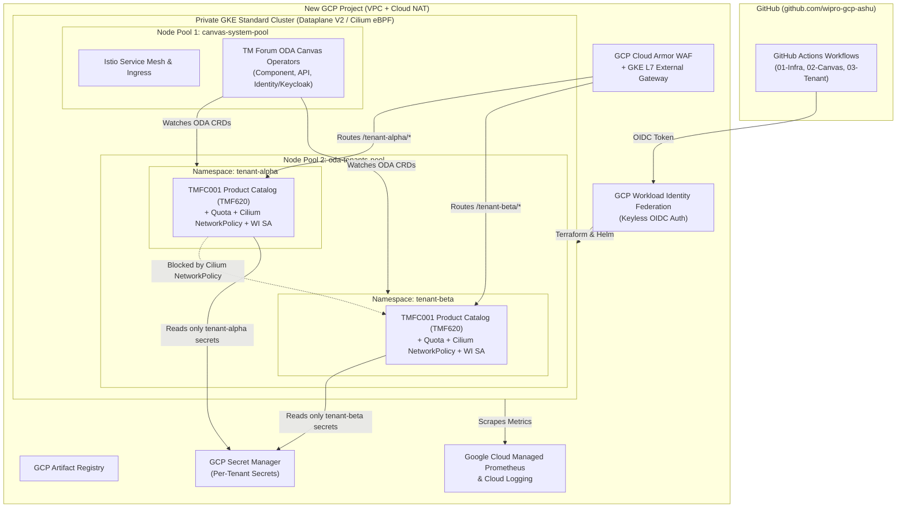

# Multi-Tenant TM Forum ODA Canvas PoC on Google Cloud (GKE Private Cluster)

This repository implements an end-to-end **Multi-Tenant TM Forum Open Digital Architecture (ODA) Canvas** Proof of Concept (PoC) on **Google Cloud Platform (GCP)** using **GKE Standard Private Cluster** and **GCP-Native Services**, fully automated via **GitHub Actions** (`https://github.com/wipro-gcp-ashu`).

---

## Architecture Overview



---

## Key GCP-Native & TM Forum ODA Capabilities

| Capability | GCP-Native & ODA Canvas Implementation |
|---|---|
| **Cluster Architecture** | **Private GKE Standard Cluster** in custom VPC with Cloud Router & Cloud NAT (no public node IPs). |
| **Workload Separation** | Dedicated `canvas-system-pool` for ODA Canvas Operators & Istio; `oda-tenants-pool` for Tenant ODA Components. |
| **Network Isolation** | **GKE Dataplane V2 (Cilium eBPF)** enforcing strict `NetworkPolicy` per tenant (`default-deny-ingress`, `allow-same-tenant`, `allow-oda-canvas-and-gcp-ingress`). |
| **API Gateway & WAF** | **GKE Gateway API (`gke-l7-global-external-managed`)** + Istio Ingress protected by **GCP Cloud Armor WAF** (SQLi/XSS protection). |
| **Identity & Secrets** | **GKE Workload Identity** binding each tenant's K8s SA (`[tenant-x/oda-tenant-sa]`) strictly to its own GCP Service Account & **GCP Secret Manager** secrets, alongside ODA Canvas Keycloak (SECOOP). |
| **Observability** | **Google Cloud Managed Service for Prometheus (GMP)** (`ClusterPodMonitoring`) + Cloud Logging & Cloud Monitoring. |
| **Sample ODA Component** | **TMFC001 Product Catalog Management (`TMF620`)** (`oda.tmforum.org/v1beta3` `Component` CRD) deployed independently per tenant. |

---

## Repository Structure

```text
├── .github/workflows/
│   ├── 01-infra-terraform.yml      # Terraform plan/apply for GCP Project, VPC, Private GKE, IAM
│   ├── 02-deploy-oda-canvas.yml    # Installs Cert-Manager, Istio, TMF ODA Canvas & Initial Tenants
│   ├── 03-onboard-tenant.yml       # Self-service workflow to onboard any new tenant & verify isolation
│   └── 99-destroy-poc.yml          # Clean teardown of GCP PoC resources
├── oda-canvas/
│   ├── canvas-values.yaml          # Helm values for tmforum-oda/canvas-oda
│   ├── istio-values.yaml           # Helm values for Istio Ingress + Cloud Armor BackendConfig
│   └── gcp-native-gateway-and-observability.yaml # GKE Gateway API + Cloud Managed Prometheus
├── scripts/
│   ├── bootstrap-gcp-wif.sh        # One-time setup: GCP Project, GCS TF state bucket & GitHub WIF
│   └── verify-multitenancy.sh      # Automated test proving intra-tenant access & cross-tenant block
├── tenants/
│   └── tenant-template/
│       ├── 01-namespace-and-quotas.yaml          # Namespace, ResourceQuota, LimitRange, RBAC, WI SA
│       ├── 02-network-policies.yaml              # Cilium eBPF NetworkPolicies isolating tenants
│       └── 03-sample-tmfc001-productcatalog.yaml # TMFC001 Component CRD, TMF620 API & HTTPRoute
└── terraform/
    ├── main.tf                     # VPC, NAT, Private GKE Standard, Node Pools, Cloud Armor, IAM
    ├── variables.tf
    ├── outputs.tf
    ├── versions.tf
    └── terraform.tfvars.example
```

---

## Step-by-Step Setup Guide

### Step 1: Create the New GitHub Repository under `wipro-gcp-ashu`
Push this repository to `https://github.com/wipro-gcp-ashu/oda-canvas-poc`:

```bash
git init
git add .
git commit -m "Initial commit: Multi-Tenant TM Forum ODA Canvas PoC on GCP"
git branch -M main
git remote add origin https://github.com/wipro-gcp-ashu/oda-canvas-poc.git
git push -u origin main
```

### Step 2: Run the GCP Project & Workload Identity Bootstrap Script
Open **Google Cloud Shell** (or local terminal authenticated with `gcloud`) and run `scripts/bootstrap-gcp-wif.sh`:

```bash
export GITHUB_OWNER="wipro-gcp-ashu"
export GITHUB_REPO="oda-canvas-poc"
export PROJECT_ID="gcp-oda-canvas-poc"
export REGION="us-central1"
export BILLING_ACCOUNT_ID="XXXXXX-XXXXXX-XXXXXX"  # Optional if project already linked to billing

chmod +x scripts/bootstrap-gcp-wif.sh
./scripts/bootstrap-gcp-wif.sh
```

### Step 3: Add GitHub Actions Repository Variables
Go to `https://github.com/wipro-gcp-ashu/oda-canvas-poc/settings/variables/actions` and create the **Repository Variables** printed at the end of Step 2:

- `GCP_PROJECT_ID`: `gcp-oda-canvas-poc`
- `GCP_REGION`: `us-central1`
- `GKE_CLUSTER_NAME`: `oda-canvas-mt-gke`
- `TF_STATE_BUCKET`: `gcp-oda-canvas-poc-tfstate`
- `WIF_PROVIDER`: `projects/<PROJECT_NUMBER>/locations/global/workloadIdentityPools/github-actions-pool/providers/github-oidc-provider`
- `WIF_SERVICE_ACCOUNT`: `github-oda-deployer@gcp-oda-canvas-poc.iam.gserviceaccount.com`

### Step 4: Run the GitHub Actions Workflows
1. **Run `01 - Provision GCP Infrastructure & Private GKE (Terraform)`**:
   - Creates the custom VPC, Cloud NAT, Private GKE Standard Cluster (Dataplane V2), `canvas-system-pool`, `oda-tenants-pool`, Cloud Armor WAF, Artifact Registry, and Tenant IAM/Secret Manager resources.
2. **Run `02 - Deploy TM Forum ODA Canvas & GCP Native Integrations`**:
   - Installs Cert-Manager, Istio, TM Forum ODA Canvas (`oda-canvas/canvas-oda`), GCP Native Gateway API, Managed Prometheus, onboards `tenant-alpha` and `tenant-beta` with **TMFC001 Product Catalog**, and runs automated cross-tenant isolation tests.
3. **Run `03 - Self-Service Onboard New ODA Canvas Tenant`**:
   - Enter any new tenant name (e.g. `tenant-gamma`) to dynamically provision a new isolated tenant namespace, GCP Secret Manager secret, Workload Identity binding, and TMFC001 Component in under 2 minutes.
